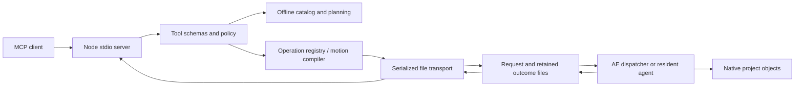

# Architecture and contracts

[README](../README.md) · [Configuration](CONFIGURATION.md) · [Development](DEVELOPMENT.md)

The server is TypeScript compiled to Node ESM. It speaks MCP on stdio and sends
ExtendScript to a running AE through a local file mailbox. Native helper code
is packaged as JSX. No CEP panel, browser frontend or network listener is
required by the normal single-instance path.

## Request flow



`ae_catalog` reads registry metadata. `ae_do` validates an operation, applies
policy, then either generates JSX or runs a Node-side operation such as instance
management. Motion planning is offline; building validates the strict spec
before generating native text/shapes/keyframes. Audit and capture inspect the
actual project through native calls.

## Source map

| Path | Responsibility |
|---|---|
| [src/index.ts](../src/index.ts) | MCP registration, stdio server and CLI routing |
| [src/tools/index.ts](../src/tools/index.ts) | Tool list and shared per-call instance routing |
| [src/tools/define-tool.ts](../src/tools/define-tool.ts) | Tool/result contracts and application-failure conversion |
| [src/registry.ts](../src/registry.ts) | Operation metadata, selectors and JSX helpers |
| [src/opschema.ts](../src/opschema.ts) | Operation parameter validation |
| [src/policy.ts](../src/policy.ts) | Read-only/category/eval policy |
| [src/operations](../src/operations/) | Native operation implementations and Node-side host controls |
| [src/transport](../src/transport/) | Launch, routing, serialization, dialogs and retained request states |
| [jsx](../jsx/) | ES3-compatible native dispatcher, resident agent and helpers |
| [src/motion](../src/motion/) | Portable specs, presets, compiler, audit and review manifest |
| [src/mcp-workflow.ts](../src/mcp-workflow.ts) | Resources and motion-graphics prompt |
| [src/schema.ts](../src/schema.ts), [src/validate.ts](../src/validate.ts) | Version-2 structural project JSON contract/validation |

## MCP result conventions

Successful tools return MCP `content` plus `structuredContent` and
`isError:false`. `jsonResult` adds `ok:true` at the root. Native calls normally
add `result`, `logs`, `durationMs`, and request tracking fields when available.
`ae_do` additionally attaches native ambient context for JSX operations.

Failures use `isError:true` and a structured envelope shaped like:

```json
{
  "ok":false,
  "error":{
    "code":"OPERATION_FAILED",
    "message":"Example application error",
    "retryable":false,
    "details":{"result":{"ok":false,"error":"Example application error"}}
  }
}
```

The transport distinguishes native execution failure from native code returning
`{ok:false}`. `toMcpResult` converts the latter into `OPERATION_FAILED`, retaining
the returned object in `error.details.result`. That can contain partial build
IDs. Error logs, duration and stack are optional. The SDK can also reject invalid
tool arguments before this application envelope is created.

Result locations are not uniform across tools. Offline plan fields, catalog
fields, review records, export results and import dry-run fields live at the
root. See each [tool reference](TOOLS.md) entry instead of assuming every payload
has `result`. Request status exposes a retained transport result, so inspect its
nested application result as well as the state.

## Dispatch, concurrency and recovery

Push dispatch uses AfterFX `-r` on Windows and the inherited AppleScript path on
macOS. A resident agent instead polls a per-instance mailbox; this is the pull
path used for explicit multi-instance routing. Both claim a request by renaming
its file before reading/executing it. Only the successful claimant executes.

The Node transport serializes calls. Durable per-mailbox gates block subsequent
host work until the prior outcome is terminal. UUID route records let
`ae_request_status` recover outcomes after an MCP process restart without
launching AE. Retained request/response files are not automatically swept by age.
The full state and lock contract is in [transport-outcomes.md](transport-outcomes.md).

This provides recovery from recorded outcomes and duplicate-dispatch resistance.
It does not guarantee exactly-once effects across arbitrary host/filesystem
failures, power-loss durability or transactional rollback. Unknown outcomes can
remain blocked until host inspection and manual repair. User scripts and other
bridges outside this mailbox are not serialized by its gates.

## Undo and destructive boundaries

Most JSX calls use an undo group and dialog suppression. Undo/redo and project
boundaries need different wrapping, declared by the operation. `batch.run`
checks each child's arguments/policy and rejects operations incompatible with
its single undo group. It can stop subsequent children after a failure but does
not reverse successful earlier children.

Project replacement guards refuse implicit loss of unsaved work. This is not a
global ban on destructive editing: layer/item removal, clearing project items,
overwriting files and explicit host controls still exist. File writes, rendered
output and many application settings do not roll back with the layer undo stack.

## Persistence and evidence

Motion specs store source intent. Native AEPs store editable project state.
Structural project JSON exposes a supported subset for interchange. Review
manifests store sample times, hashes, audit observations and artist acceptance
status. These artifacts serve different purposes; none replaces the others.

Native IDs are valid only in their project context. The spec hash is source
provenance, not current-state verification after edits. Review hashes identify
captured bytes, not all frames in an animation. The manifest explicitly records
`coverage:"sampled_frames_only"` and `artistAcceptance:"pending"`.

## Resources and prompt

| MCP interface | Contract |
|---|---|
| `ae-uber://workflow` | Text/plain continuation guide |
| `ae-uber://motion-spec-schema` | Application/json schema for version-1 specs |
| `ae-uber://skills/after-effects-motion-design/manifest.json` | Portable skill file list; every listed file is exposed as an exact read-only resource under this prefix |
| `motion-graphics` prompt | Required string `brief`; returns a user message combining the brief with the workflow guide |

Resources and prompts guide the client; they do not perform native mutations.
Tool results and independent inspection still determine what happened.

## Trust boundary

The policy lives in Node; the native dispatcher executes the code placed in its
mailbox. An account that can write mailbox requests can execute code in AE.
Filesystem isolation and user permissions therefore matter independently of
read-only/category policy. Eval is disabled by default, but enabling it allows
arbitrary ExtendScript within AE's privileges. Capture/export path guards cover
their own outputs; they do not turn the bridge into a sandbox.

This derivative separates its default runtime namespace from upstream Kumo.
Resident-agent global names still overlap upstream, so use one bridge per host
session. See [validation](VALIDATION.md) for the narrower set of native behaviors
actually exercised, including the unqualified multi-instance/OS boundaries.
